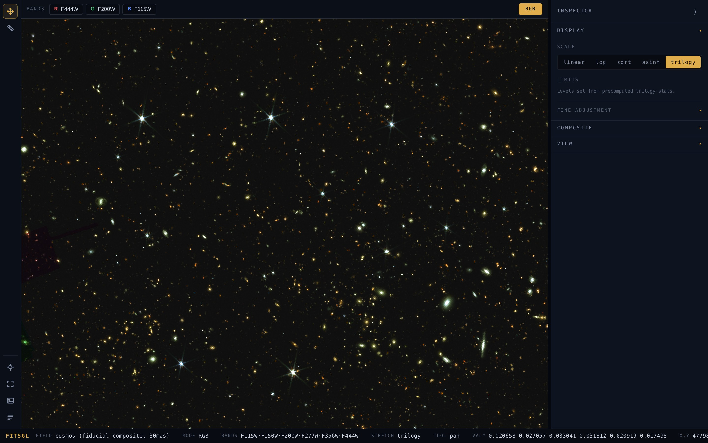
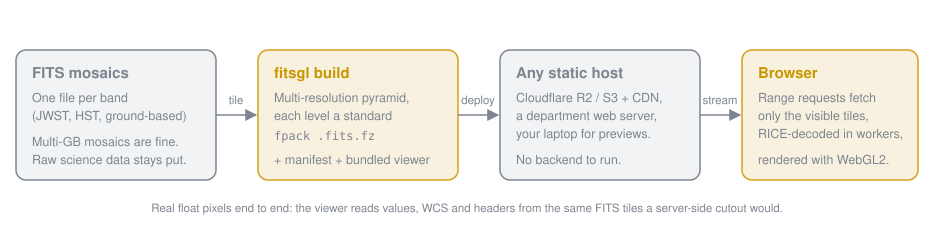

# FitsGL

**Pan and zoom through a multi-gigabyte JWST mosaic in a browser tab, straight
from a static file host, with real pixel values under the cursor.**

FitsGL turns FITS mosaics into tiled, multi-resolution pyramids of ordinary
fpack-compressed FITS files, and renders them in WebGL2. There is no image
server, no reprojection, and no conversion to PNG: the browser fetches only the
byte ranges it needs, decodes the RICE tiles itself, and draws the float data
with a live stretch. Build once with a Python CLI, host the output anywhere that
serves static files, and share a link.

[](https://github.com/hollisakins/fitsgl/actions/workflows/ci.yml)
[](https://www.npmjs.com/package/@fitsgl/core)

<p align="center">
  
  <br><sub>COSMOS-Web NIRCam composite (22 bands at 30 mas/pixel), streamed tile by tile from
  <code>tiles.campfire-jwst.org</code> into the stock viewer. Nothing here was pre-rendered.</sub>
</p>

## Why

Survey mosaics have outgrown the download-then-DS9 workflow. The usual fix is a
web viewer built on pre-rendered PNG or JPEG tiles, which throws away the
pixel values, the stretch, and the ability to recombine bands. FitsGL keeps the
science data format all the way to the screen:

- **Real FITS, real floats.** Every tile is a standard fpacked FITS file that
  astropy, `funpack`, and DS9 can open. The viewer shows the actual pixel value,
  RA/Dec, and the original header. Compression is `RICE_1` with `quantize_level=8`
  and subtractive dithering, which is photometry-faithful to about 0.03%.
- **Static hosting only.** Output is a directory of files. Serve it from
  Cloudflare R2, S3, a department web server, or your laptop. No database, no
  tile server, no backend to keep alive.
- **Fast at survey scale.** Multi-resolution pyramid, HTTP range requests for
  just the tiles in view, decoding on a pool of web workers, and three cache
  tiers (GPU, RAM, and a persistent on-disk cache of compressed tiles) so
  revisiting a field is nearly instant.
- **Astronomer controls, not photo-editor controls.** Linear, sqrt, log, asinh
  and Trilogy stretches. Zscale and percentile presets with live histograms.
  RGB and weighted multi-band composites. North-up, a ruler, go-to-coordinate,
  catalog overlays, PNG export, and shareable view links.

## Quickstart

Requires Python 3.10+. Try the viewer on a synthetic dataset first:

```bash
pip install "fitsgl @ git+https://github.com/hollisakins/fitsgl.git#subdirectory=fitsgl-py"
```

```bash
fitsgl demo --serve
```

Open the printed URL. For your own data:

```bash
cd /path/to/mosaics
fitsgl init            # scan headers, detect filters, scaffold fitsgl.toml
fitsgl build           # -> dist/<name>/ (tiles + manifest + viewer)
fitsgl serve dist/<name>
```

`fitsgl init` groups co-gridded bands, picks an RGB default when it finds three
broadbands on one grid, and leaves a commented config for you to tweak. The
build is resumable and parallel. Add a `catalog = "sources.csv"` line to overlay
RA/Dec markers.

To publish, copy `dist/<name>/` to any host that honours HTTP `Range` requests,
or let the CLI push it to Cloudflare R2 and purge the CDN edge:

```bash
pip install "fitsgl[deploy] @ git+https://github.com/hollisakins/fitsgl.git#subdirectory=fitsgl-py"
fitsgl deploy          # reads [deploy] from fitsgl.toml; uploads only changed files
fitsgl verify https://data.example.org/cosmos   # check Range / MIME / CORS on the live URL
```

Full command reference: [docs/cli.md](docs/cli.md). One-time R2 setup:
[docs/r2-setup.md](docs/r2-setup.md). Many fields in one bucket with a landing
page: the workspace section of [docs/cli.md](docs/cli.md#multiple-fields-workspace).

## How it works

<p align="center">
  
</p>

1. **Build.** For each band, `fitsgl build` block-averages the mosaic into a
   pyramid of levels (native resolution down to a single 256 px tile) and writes
   each level as fpacked FITS with 256×256 internal tiles. Large levels are
   split into disjoint "supertile" files so no object exceeds CDN size limits.
   A `manifest.json` per band and a `fitsgl.json` per dataset describe the grid,
   WCS, and default view. A copy of the viewer (`index.html` + assets) sits next
   to the data, so the output directory is a complete website.
2. **Serve.** fpack's tile table makes every 256×256 tile independently
   addressable by byte offset, so a plain static server with `Range` support is
   all the client needs.
3. **Render.** The TypeScript library (`@fitsgl/core`) range-fetches visible
   tiles, decodes RICE and GZIP_2 with a hand-written decoder (bit-exact against
   astropy), uploads float textures to WebGL2, and applies stretch, colormap, and
   RGB composition in the shader. Panning, zooming, and restretching never
   re-fetch data.

Pre-tiled mosaics (many FITS files on one grid, differing only in `CRPIX`) are
ingested directly as a single band.

## Embed the viewer in your own site

The viewer is published as [`@fitsgl/core`](https://www.npmjs.com/package/@fitsgl/core)
(ESM, TypeScript, no runtime dependencies). The React component is the shortest
path:

```tsx
import { FitsExplorer } from '@fitsgl/core/react';
import { loadFitsglConfig } from '@fitsgl/core';

const config = await loadFitsglConfig('https://data.example.org/cosmos/fitsgl.json');

<div style={{ width: '100vw', height: '100vh' }}>
  <FitsExplorer config={config} />
</div>;
```

A framework-free `FitsViewer` class, a bare `<FitsViewer>` React canvas with an
imperative handle, marker and tooltip hooks, and WCS and stretch utilities are
all exported. See [docs/core-integration.md](docs/core-integration.md).

## Server-side cutouts from the same tiles

The Python package also exposes a read-side API: given a band manifest and a
sky region, `plan_cutout` picks the matching pyramid level and returns the
exact `.fits.fz` files and byte ranges that cover it. A cutout service can
range-read a few hundred kB from the bucket instead of opening the full mosaic.
See [docs/server-reads.md](docs/server-reads.md).

## What it does not do (yet)

- The pyramid is a **display product**. Ship the lossless mosaic separately for
  measurements.
- **ICRS + TAN only.** SIP and TPV distortions are rejected at build time.
- **No reprojection.** Bands composited in RGB must share a pixel grid; FitsGL
  will NaN-pad differing footprints but will not resample.
- Needs a browser with WebGL2 and `DecompressionStream` (any current Chrome,
  Firefox, Safari, or Edge).

## Repository layout

| Directory | What it is |
| --- | --- |
| `fitsgl-py/` | Python pipeline and the `fitsgl` CLI (`init`, `build`, `demo`, `serve`, `verify`, `deploy`, `index`), plus the cutout read API. |
| `fitsgl-core/` | TypeScript library `@fitsgl/core`: RICE/fpack decoders, tile engine, WebGL2 renderer, WCS, overlays, React components. |
| `viewer/` | The standalone viewer app that `fitsgl build` bundles next to each dataset. |
| `demo/` | Vite app for end-to-end checks of the non-React stack. |
| `docs/` | [CLI](docs/cli.md) · [embedding](docs/core-integration.md) · [cutouts](docs/server-reads.md) · [R2 hosting](docs/r2-setup.md) · [dev preview](docs/dev-preview.md) |

## Developing

```bash
cd fitsgl-py && pip install -e ".[test]" && pytest
cd fitsgl-core && npm install && npm test && npm run typecheck
npm --prefix viewer run build-vendor   # re-bundle the viewer after core/viewer changes
```

Decode correctness is pinned by tests against astropy-generated fixtures; RICE
and GZIP_2 round-trips are bit-exact. Issues and pull requests are welcome at
[github.com/hollisakins/fitsgl](https://github.com/hollisakins/fitsgl/issues).

## License

MIT.
